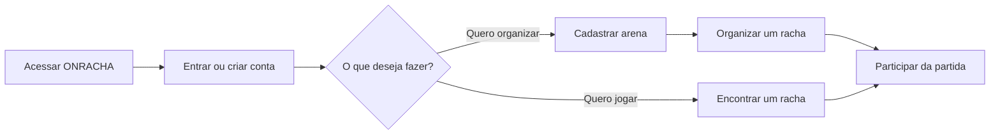

# ONRACHA

Plataforma em desenvolvimento para cadastrar arenas, organizar e encontrar jogos para participar.

## Fluxo principal



## Executar com Docker Compose

Copie `.env.example` para `.env` se quiser personalizar os valores locais. Os valores padrão são apenas para desenvolvimento e não devem ser usados em produção.

Na raiz do repositório, execute:

```bash
docker compose up
```

O Compose inicia PostgreSQL, aplica migrations pendentes, inicia a API e inicia o frontend:

- Frontend: <http://localhost:5173>
- API: <http://localhost:8080>
- Swagger UI: <http://localhost:8080/swagger>
- OpenAPI: <http://localhost:8080/openapi.yaml>
- PostgreSQL: `localhost:5432`

Para encerrar, pressione `Ctrl+C`. Se os serviços foram iniciados em segundo plano, use:

```bash
docker compose down
```

O volume `postgres_data` mantém os dados locais. `docker compose down -v` também apaga esse volume.

## Documentação

- [Backend e testes](backend/README.md)
- [Guia de contribuição e TDD](CONTRIBUTING.md)
- [Especificação OpenAPI](docs/openapi.yaml)
- [ADR](docs/adr)
