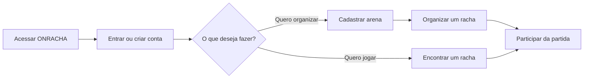

# ONRACHA

Plataforma em desenvolvimento para cadastrar arenas, organizar e encontrar jogos para participar.

## Fluxo principal



## Executar com Docker Compose

Na raiz do repositório, execute:

```bash
docker compose up
```

O Compose inicia os três serviços:

- Frontend: <http://localhost:5173>
- Backend: <http://localhost:8080>
- PostgreSQL: `localhost:5432`

Para encerrar, pressione `Ctrl+C`. Se os serviços foram iniciados em segundo plano, use:

```bash
docker compose down
```